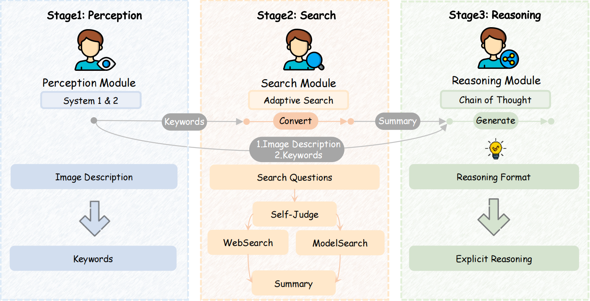
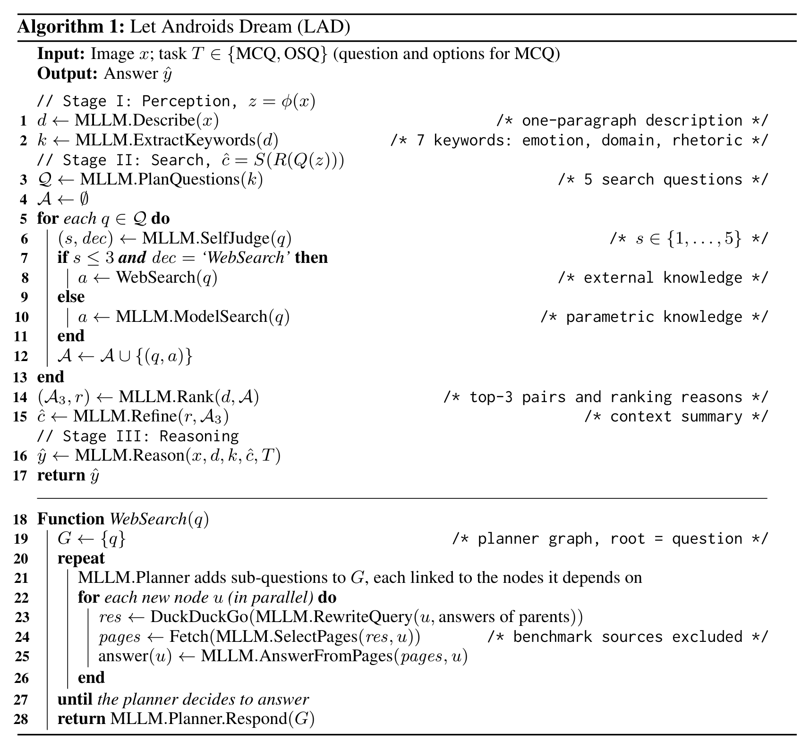
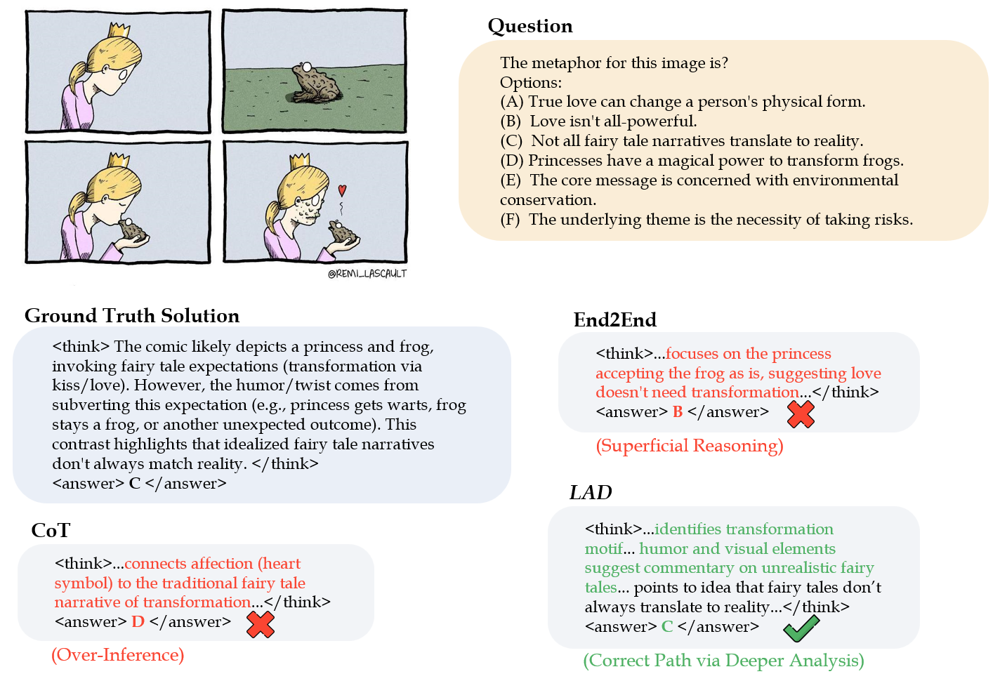
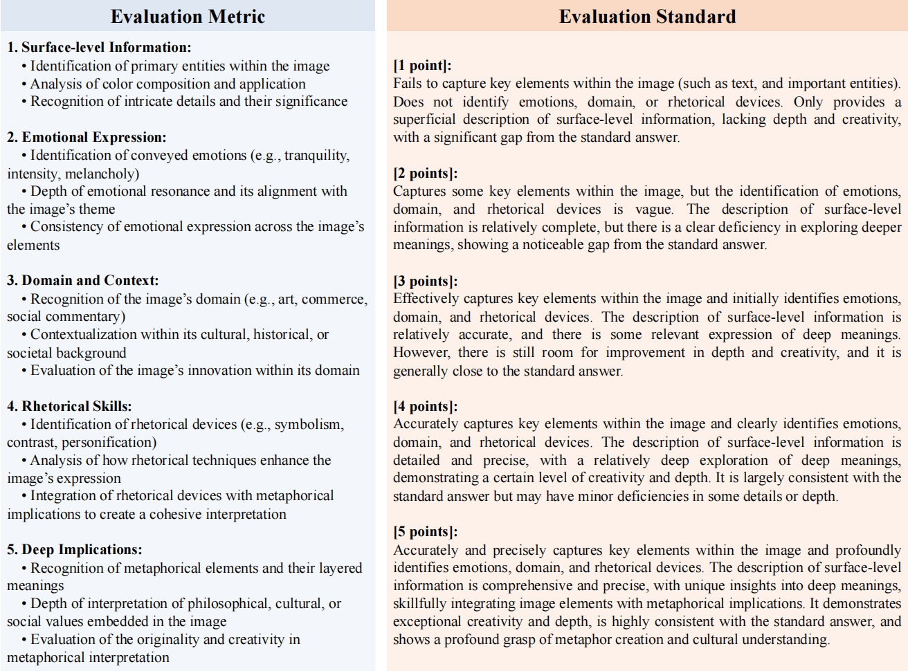
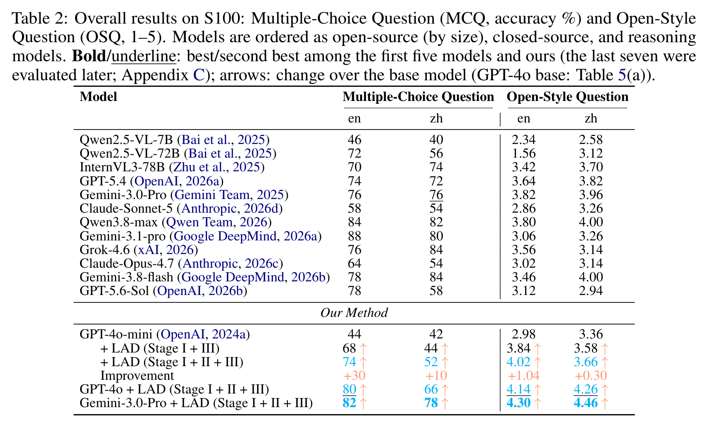
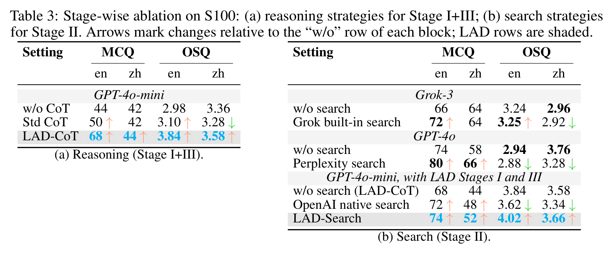
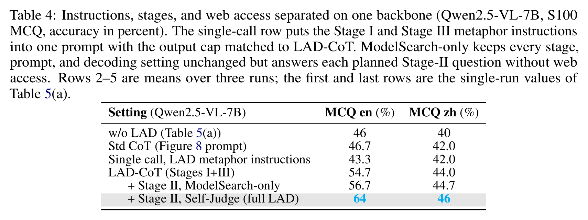
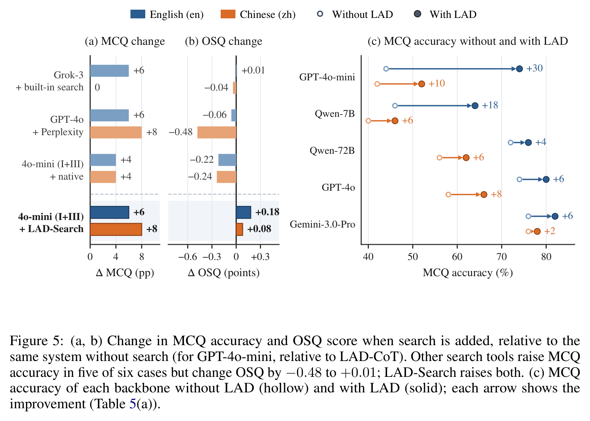
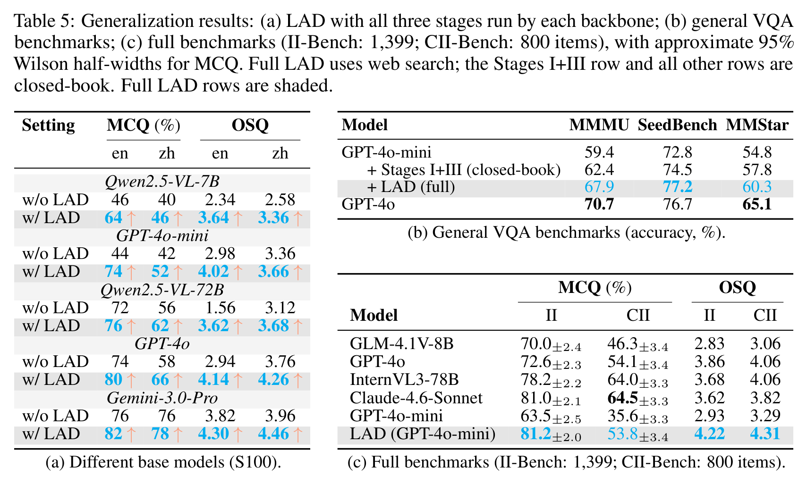

# Let Androids Dream: From Visual Elements to Emergent Implications via Contextual Alignment

[**Project Page**](https://ming-zch.github.io/lad) | [**arXiv Paper (v3)**](https://arxiv.org/abs/2505.17019) | [**CVPR 2026 CogVL Workshop**](https://openreview.net/forum?id=RUNGZuEWvT)

## 🔥 News
- **[Nov. 2026]**: Updated our paper on [arXiv (v3)](https://arxiv.org/abs/2505.17019) under the new title *"Let Androids Dream: From Visual Elements to Emergent Implications via Contextual Alignment"*, reframing LAD around test-time contextual alignment with expanded backbone, ablation, and statistical analyses.
- **[2026]**: *"Let Androids Dream of Electric Sheep: A Human-Inspired Image Metaphor Understanding and Reasoning Framework"* was presented as a poster at the **CVPR 2026 CogVL Workshop** ([OpenReview](https://openreview.net/forum?id=RUNGZuEWvT)).
- **[Dec. 2025]**: Updated our paper on [arXiv (v2)](https://arxiv.org/abs/2505.17019v2) (*"Let Androids Dream of Electric Sheep: A Human-Inspired Image Implication Understanding and Reasoning Framework"*).
- **[May. 2025]**: Released the initial paper on [arXiv (v1)](https://arxiv.org/abs/2505.17019v1) (*"Let Androids Dream of Electric Sheep: A Human-Inspired Image Implication Understanding and Reasoning Framework"*).
- **[May. 2025]**: Released our code and evaluation dataset!

## Introduction

Image metaphor understanding differs from general VQA: the implied meaning is rarely explicit in pixels and instead emerges from the *compositional interaction* of visual elements together with social intent and culture-specific background. We identify **missing context**, namely cultural, social, or rhetorical conventions already in a model's weights that single-pass inference leaves unused and external facts absent from the weights, as a failure mode of current multimodal large language models (MLLMs). We formalize **Contextual Alignment** as inference over a latent context: selecting background knowledge that is relevant to the image's composition and useful for inferring its implication.

We propose ***Let Androids Dream (LAD)***, a training-free, backbone-agnostic framework that operationalizes contextual alignment through test-time computation in three stages:
1. **Perception**: extracts compositional visual structure from the image into a description and metaphor-oriented keywords.
2. **Search**: adaptively acquires missing context from parametric knowledge or web search guided by the perceived composition.
3. **Reasoning**: aligns visual compositions with the acquired context to derive emergent implications.

On **S100** (100 high-level implication questions in English and Chinese), LAD raises the lightweight GPT-4o-mini from 44% to 74% (English) and from 42% to 52% (Chinese) on Multiple-Choice Questions (MCQ), on par with closed-book GPT-5.4 in English (74%), and from 2.98 to 4.02 (English) and 3.36 to 3.66 (Chinese) on Open-Style Questions (OSQ). LAD improves all five tested backbones, including the open-source Qwen2.5-VL-7B (+18 MCQ and +1.30 OSQ points in English), Qwen2.5-VL-72B, GPT-4o-mini, GPT-4o (4.14 and 4.26 OSQ), and Gemini-3.0-Pro, where it obtains the highest OSQ scores (4.30 and 4.46). Its gains hold at scale on the full II-Bench (1,399 items) and CII-Bench (800 items). Across search-augmented comparisons, adding other search tools raises MCQ accuracy in five of six cases but changes OSQ scores by -0.48 to +0.01, whereas LAD's search stage improves both, indicating that how context is acquired and selected matters beyond access to search. Our OSQ automatic judge is within one point of trimmed human means for 95.7% of answers, and LAD with web search also improves MMMU, SeedBench, and MMStar.

For project details and resources, visit the [project page](https://ming-zch.github.io/lad).

## Method



### Stage I: Perception

Transforms the raw image into a structured perceptual abstraction ($z = \phi(x)$):
* **Extract Image Description**: generates a one-paragraph description covering discernible text, prominent colors, layout, and salient objects or entities.
* **Summarize Keywords**: condenses the description into seven keywords capturing perceived emotion, domain or context (e.g., political, social, cultural), rhetorical devices (including puns and homophones), and key textual elements or entities.

Please run the [LAD](LAD_code.ipynb) (Stage I) code.

### Stage II: Search

Performs perception-guided context acquisition ($\hat{c} = S(R(Q(z)))$) in three phases (**Plan**, **Search**, and **Summary**) to address both unused parametric conventions and external facts:
* **Plan (Construct Search Questions)**: generates five search questions from the Stage-I keywords targeting latent meanings, cultural references, or background of keyword combinations.
* **Self-Judge**: assigns each question a 1–5 confidence score and a routing decision (lowering the score for internet or meme culture, highly popular knowledge, real-time content, niche entities, and questions involving more than two entities). Questions scored $\le 3$ with a `WebSearch` decision are routed to WebSearch; questions scored $> 3$ (or inconsistent/malformed outputs) are routed to ModelSearch.
* **ModelSearch**: answers the question from the MLLM's own parametric knowledge using a prompt tailored to memes and image metaphors.
* **WebSearch**: uses a MindSearch-style planner–searcher dependency graph over DuckDuckGo with text-only queries derived from Stage I (benchmark sources excluded; neither the image nor benchmark questions/options are sent to the search engine).
* **Rank & Refine (Summary)**: **RankSummary** ranks the five question–answer pairs by relevance to the implied metaphor and keeps the top three; **RefineSummary** condenses them into a concise context summary ($\hat{c}$).

Please run the [LAD](LAD_code.ipynb) (Stage II) code.

*Note: To setup WebSearch, please refer to [LAD-WebSearch](LAD-WebSearch/README.md) for more details.*

### Stage III: Reasoning

Aligns the image, Stage-I perception outputs, and Stage-II context summary ($\hat{c}$) to infer the emergent implication:
* **Construct Reasoning Format**: combines the original image, description, seven keywords, and search summary.
* **Explicit Reasoning**: for MCQ, produces explicit reasoning inside `<think>...</think>` tags and selects the option inside `<answer>...</answer>`; for OSQ, states the implication concisely under the same instruction given to all baselines.

Please run the [LAD](LAD_code.ipynb) (Stage III) code.

### LAD Pipeline

To get a clear understanding of the LAD pipeline, we provide a simple example script illustrating the end-to-end process. Please refer to [LAD_pipeline_example.py](LAD_pipeline_example.py) for more details.



## Evaluation

Our evaluation uses two image implication benchmarks, [II-Bench](https://github.com/II-Bench/II-Bench) (English, 1,399 test items) and [CII-Bench](https://github.com/MING-ZCH/CII-Bench) (Chinese, 800 test items), evaluated at two scales:
* **S100**: a manually selected 100-item high-level subset comprising 50 English items from II-Bench and 50 Chinese items from CII-Bench across diverse domains and visual formats (comics, illustrations, posters, memes, paintings, and logos). The full item list with metadata (language, benchmark, item ID, image file, domain, and image type) is provided in [`s100_items.json`](s100_items.json).
* **Full II-Bench & CII-Bench**: full-scale evaluation on all 1,399 II-Bench and 800 CII-Bench items (2,199 items in total).

To reproduce the 95% Wilson confidence intervals and approximate unpaired two-proportion $z$-tests reported in the paper's statistical analysis appendix (Appendix D), run [`stats.py`](stats.py):

```bash
python3 stats.py
```

*Note: Please refer to [evaluation](evaluation/) for the S100 benchmark files and images.*

### Multiple-Choice Question (MCQ)

Each image is paired with one six-option question (most asking *"What is the implication in this image?"* or targeting key details behind the implication), and accuracy is measured against the ground-truth option.



### Open-Style Question (OSQ)

To complement MCQ and mitigate multiple-choice biases, we evaluate open-ended implication generation using the fixed prompt asking for the image's implication. Each answer is scored holistically from 1 to 5 by GPT-4o (`gpt-4o-2024-11-20`, temperature 0) given the image and the benchmark's human-written reference answer, across five perspectives: ***Surface-level Information***, ***Emotional Expression***, ***Domain and Context***, ***Rhetorical Skills***, and ***Deep Implications***. In a validation study with 16 bilingual PhD students and researchers across 50 randomly sampled S100 images (25 per language), the automatic judge is within one point of the trimmed human mean for 95.7% of answers (96.5% English, 94.8% Chinese).



## Experiments

### Main Results on S100

On S100, LAD lifts GPT-4o-mini by +30 English MCQ points (44% to 74%, $p = 0.002$) and +10 Chinese MCQ points (42% to 52%), and raises OSQ from 2.98 to 4.02 (English) and 3.36 to 3.66 (Chinese). Applied to GPT-4o and Gemini-3.0-Pro, LAD further improves both MCQ and OSQ, reaching 4.14 / 4.26 OSQ with GPT-4o and 4.30 / 4.46 OSQ with Gemini-3.0-Pro.



### Stage-wise Ablation

Both staged perception-and-reasoning (LAD-CoT, Stage I+III) and adaptive search (LAD-Search, Stage II) contribute to performance. On GPT-4o-mini, LAD-CoT raises English MCQ from 44% to 68% and OSQ from 2.98 to 3.84 (compared to 50% and 3.10 for standard CoT), and adding LAD-Search further improves all four metrics (74% / 52% MCQ, 4.02 / 3.66 OSQ). In contrast, replacing Stage II with generic search tools lowers OSQ scores.



### Instructions vs. Stages and Web Access Decomposition

To separate prompt instructions from staged execution and web retrieval on a single backbone (Qwen2.5-VL-7B), placing the LAD metaphor instructions into a single call yields 43.3% / 42.0% MCQ (en / zh), whereas executing them as separate stages (LAD-CoT) reaches 54.7% / 44.0%. Adding Stage II with parametric `ModelSearch` alone reaches 56.7% / 44.7%, and enabling `Self-Judge` routing to web search reaches 64% / 46%. Both the staged decomposition with parametric recall and the external web retrieval contribute.



### Search and Backbone Gain Analysis

Across search-augmented comparisons, other search tools increase MCQ accuracy in five of six cases but change OSQ by -0.48 to +0.01, whereas LAD-Search raises both MCQ (+6 en, +8 zh) and OSQ (+0.18 en, +0.08 zh) over LAD-CoT. Across all five tested backbones, LAD consistently improves MCQ accuracy in both languages.



### Generalization Across Backbones, General VQA, and Full Benchmarks

LAD improves all five tested backbones on S100 (Qwen2.5-VL-7B, GPT-4o-mini, Qwen2.5-VL-72B, GPT-4o, and Gemini-3.0-Pro) with unchanged prompts. On the full II-Bench (1,399 items) and CII-Bench (800 items), LAD raises GPT-4o-mini from 63.5% to 81.2% and 35.6% to 53.8% MCQ ($p < 10^{-12}$ for both) and from 2.93 to 4.22 and 3.29 to 4.31 OSQ. On general VQA benchmarks with GPT-4o-mini, closed-book Stages I+III improve MMMU (59.4% to 62.4%), SeedBench (72.8% to 74.5%), and MMStar (54.8% to 57.8%), and full LAD with web search reaches 67.9%, 77.2%, and 60.3%.



## Citation

If you find our work helpful in your research, please cite the latest arXiv preprint or the CVPR 2026 CogVL Workshop paper:

```bibtex
@article{zhang2026lad,
  title={Let Androids Dream: From Visual Elements to Emergent Implications via Contextual Alignment},
  author={Chenhao Zhang and Yazhe Niu},
  journal={arXiv preprint arXiv:2505.17019},
  year={2026}
}
```

```bibtex
@inproceedings{zhang2026lad_cogvl,
  title={Let Androids Dream of Electric Sheep: A Human-Inspired Image Metaphor Understanding and Reasoning Framework},
  author={Chenhao Zhang and Yazhe Niu},
  booktitle={CVPR 2026 Workshop (CogVL)},
  year={2026},
  url={https://openreview.net/forum?id=RUNGZuEWvT}
}
```

## Acknowledgments

* [II-Bench](https://github.com/II-Bench/II-Bench): An English Image Implication Understanding Benchmark for Multimodal Large Language Models ***(NeurIPS 2024)***
* [CII-Bench](https://github.com/MING-ZCH/CII-Bench): Can MLLMs Understand the Deep Implication Behind Chinese Images? ***(ACL 2025)***
